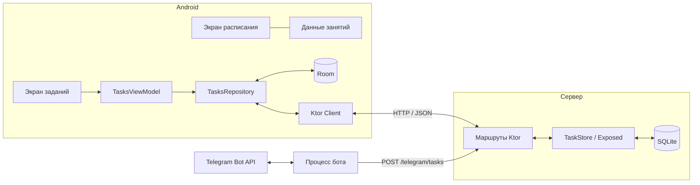

# Структура UniFlow

```text
UniFlow/
├── README.md
├── PROJECT_STRUCTURE.md
├── android/
│   ├── app/
│   │   ├── schemas/                   # Схема базы Room
│   │   └── src/
│   │       ├── main/
│   │       │   ├── java/com/example/uniflow/
│   │       │   │   ├── MainActivity.kt  # Навигация
│   │       │   │   ├── Screen.kt
│   │       │   │   ├── ScheduleContent.kt
│   │       │   │   ├── LessonData.kt
│   │       │   │   ├── LessonInfo.kt
│   │       │   │   ├── TasksScreen.kt
│   │       │   │   ├── TaskCard.kt
│   │       │   │   ├── TasksViewModel.kt
│   │       │   │   ├── TasksUiState.kt
│   │       │   │   ├── TaskInfo.kt
│   │       │   │   ├── TasksRepository.kt
│   │       │   │   ├── ApiClient.kt
│   │       │   │   ├── CreateTaskRequest.kt
│   │       │   │   ├── TaskDto.kt
│   │       │   │   ├── TaskDao.kt
│   │       │   │   ├── TaskEntity.kt
│   │       │   │   ├── DatabaseProvider.kt
│   │       │   │   ├── AppDatabase.kt
│   │       │   │   └── ui/theme/       # Тема Compose
│   │       │   ├── res/                # Ресурсы приложения
│   │       │   └── AndroidManifest.xml
│   │       ├── test/                   # Модульные тесты
│   │       └── androidTest/            # Тесты на устройстве
│   ├── gradle/                        # Версии зависимостей и Gradle Wrapper
│   └── settings.gradle.kts
└── backend/
    ├── src/
    │   ├── main/
    │   │   ├── kotlin/
    │   │   │   ├── main.kt            # Запуск и настройка Ktor
    │   │   │   ├── Routing.kt          # HTTP-маршруты
    │   │   │   ├── TaskDto.kt
    │   │   │   ├── Serialization.kt
    │   │   │   ├── DatabaseFactory.kt
    │   │   │   ├── TaskStore.kt        # Операции с задачами
    │   │   │   ├── TasksTable.kt
    │   │   │   ├── TelegramUpdatesTable.kt
    │   │   │   └── bot/               # Команды, опрос Telegram и отправка в UniFlow
    │   │   │       ├── BotMain.kt
    │   │   │       ├── BotSettings.kt
    │   │   │       ├── BotWorker.kt
    │   │   │       ├── TaskCommandParser.kt
    │   │   │       ├── TelegramClient.kt
    │   │   │       ├── TelegramModels.kt
    │   │   │       └── UniFlowBotApi.kt
    │   │   └── resources/             # Параметры Ktor и логирования
    │   └── test/                      # Тесты API
    ├── gradle/                        # Версии зависимостей и Gradle Wrapper
    ├── requests.http                  # Пример запроса к серверу
    └── settings.gradle.kts
```

## Как приложение получает задания



При обновлении списка приложение получает задания с сервера и сохраняет их в Room. При создании, отметке выполнения или удалении оно сначала отправляет запрос на сервер, затем обновляет локальные данные. Бот сохраняет задания через внутренний маршрут того же API. SQLite хранит и задания, и идентификаторы обработанных обновлений Telegram. Экран расписания читает демонстрационные занятия из исходников.
